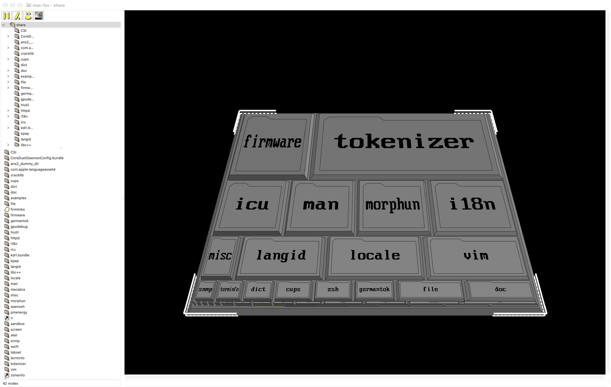
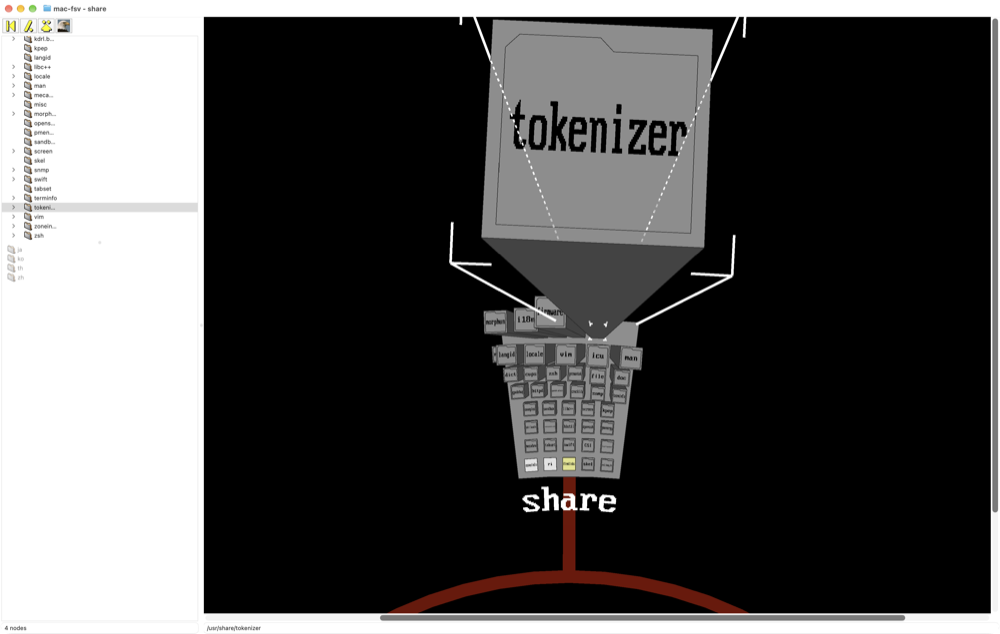
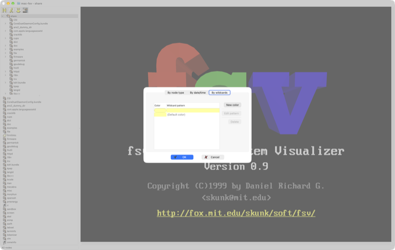

<h1 align="center">mac-fsv</h1>

<p align="center">
  <em>“It's a UNIX system! I know this!”</em><br>
  The 3D file system visualizer from <em>Jurassic Park</em>, as a native macOS app.
</p>

<p align="center">
  
  
  
  
  
</p>

<p align="center">
  
</p>

**mac-fsv** is a port of [fsv 0.9](https://fsv.sourceforge.net/), the
“3D File System Visualizer” written by Daniel Richard G. in 1999. fsv was
modelled on *fsn*, the Silicon Graphics tool seen on screen in *Jurassic
Park*. It shows a directory tree as a 3D landscape that you fly through with
the mouse.

The port keeps the original look:

- flat-shaded, lit blocks and “cel lines”;
- bitmap-font labels and fog;
- the dashed cursor;
- camera flights and the 3D “About” presentation.

fsv's C code runs almost unchanged. AppKit and Metal replace GTK+, GLib and
OpenGL, and no third-party library is used.

<table>
  <tr>
    <td></td>
    <td></td>
  </tr>
  <tr>
    <td align="center"><b>TreeV</b>: the tree in concentric rings</td>
    <td align="center"><b>About</b>: the original presentation, in 3D</td>
  </tr>
</table>

## Features

- **Two visualizations**
  - *MapV*: each directory is a platform, and its files are blocks sized by
    file size.
  - *TreeV*: the tree is laid out in concentric rings around the root.
- **3D navigation**: click to fly to a node, drag to move the view, rotate
  the camera, zoom, bird's-eye view.
- **Coloring**
  - by node type;
  - by timestamp (access, modification or attribute change), with
    configurable color ramps;
  - by file name patterns (wildcards), reordered by drag and drop.
- **macOS interface**
  - directory tree and file list, kept in sync with the 3D view;
  - a properties sheet for each node (including the output of `file`);
  - a context menu;
  - the original HTML help.
- **“1999” rendering**, optional: low-resolution rendering brings back the
  chunky pixels of an SGI workstation.

## Building

You only need the Xcode command line tools:

```bash
xcode-select --install
```

Build:

```bash
make
```

Run:

```bash
open build/mac-fsv.app
```

`make run` builds and launches in one step, and `make clean` removes the
build output. The app is a universal binary (Apple Silicon and Intel) for
macOS 14 or later, signed ad hoc. Copy it to `/Applications` to keep it.

### Opening a directory

At launch, mac-fsv asks which directory to show. You can switch to another
root later with **File ▸ Change root…** (⌘N), or by dropping a folder on the
app icon. From the command line, you can pass the directory and the starting
mode (`--mapv`, the default, or `--treev`):

```bash
build/mac-fsv.app/Contents/MacOS/mac-fsv ~/Projects --treev
```

## Controls

| Action | Gesture |
| --- | --- |
| Fly to a node | click |
| Move the view *(new in mac-fsv)* | drag |
| Rotate the camera | ⌃ or ⌘ + drag |
| Move forward / back | ⌥ + drag, middle-button drag, scroll wheel, pinch |
| Context menu | right-click (or ⌃-click in the lists) |
| Change root | File ▸ Change root… (⌘N) |
| MapV / TreeV | Vis ▸ MapV (⌘1) / TreeV (⌘2) |
| Colors | Colors ▸ By node type / By timestamp / By wildcards / Setup… |
| Low-resolution rendering | View ▸ Low-Resolution Rendering (⌃⌘L) |

## Under the hood

```
src/core/     fsv 0.9's C code (geometry, camera, animation, colors,
              disk scanning, texture-mapped font…), changed as little as possible
src/compat/   glib.c          minimal GLib replacement (lists, trees, chunks)
              minigl.c        the subset of OpenGL 1.1 that fsv uses
              minigl_metal.m  Metal renderer for that subset
src/mac/      the AppKit interface that replaces GTK+ (window, 3D view,
              directory tree, file list, dialogs, menus)
tools/        builds the app icon from the original XPM
resources/    Info.plist, original HTML help, license, authors
```

OpenGL is deprecated on macOS, and fsv uses it the old way: immediate mode
(`glBegin`/`glEnd`), display lists and `GL_SELECT` picking. Instead of
rewriting fsv's rendering code, mac-fsv provides **minigl**, an
implementation of just the calls fsv makes, on top of Metal. minigl
reproduces:

- the flat-shaded “headlight” lighting;
- wide and stippled lines;
- line polygon mode with edge flags;
- linear fog;
- the font's 4-bit intensity texture;
- picking.

Display lists are flattened and grouped by render state into Metal buffers.
This keeps the number of draw calls per frame low, even on a large tree.

### Differences from fsv 0.9

- **Dragging moves the view.** In fsv, a left-button drag did nothing. In
  mac-fsv, the point on the ground under the pointer stays under the
  pointer. A plain click keeps its original meaning.
- **The highlight is drawn at the end of the frame.** fsv drew it straight
  into the front buffer with `glCopyPixels`.

## Debugging

With `MACFSV_DEBUG=1`, the app logs these every second:

- frames rendered and frames shown on screen;
- frame cost and latency to the screen;
- mouse event handling.

`MACFSV_SCRIPT` replays a scenario without touching the mouse.
`MACFSV_SNAPDIR` sets where window captures are saved:

```bash
MACFSV_DEBUG=1 MACFSV_SCRIPT="expandall:some/dir;wait:4;revolve:3;pan:6,0,1;snap:end;quit" MACFSV_SNAPDIR=/tmp build/mac-fsv.app/Contents/MacOS/mac-fsv ~/Projects
```

| Command | Effect |
| --- | --- |
| `lookat:path` | fly to a node (path relative to the root) |
| `expandall:path` | expand a directory recursively |
| `mapv`, `treev` | switch visualization |
| `wait:s` | wait *s* seconds |
| `revolve:s` | rotate the camera for *s* seconds |
| `scroll:s` | move the horizontal scrollbar back and forth for *s* seconds |
| `hover:s` | move the pointer over the view (node hovering) for *s* seconds |
| `pan:dx,dy,s` | drag by *dx*, *dy* pixels per frame, at 60 Hz, for *s* seconds |
| `mark`, `probe` | remember the camera's target point (`mark`), then log where it is on screen (both) |
| `snap:name` | capture the window to `$MACFSV_SNAPDIR/name.png` |
| `quit` | quit |

## Credits and license

- **fsv**: © 1999 Daniel Richard G., under the
  [GNU LGPL, version 2 or later](resources/COPYING). See also
  [resources/AUTHORS](resources/AUTHORS).
- **macOS port**: distributed under the same license.

*Jurassic Park* is a trademark of Universal Studios and Amblin
Entertainment. mac-fsv is not affiliated with them.
